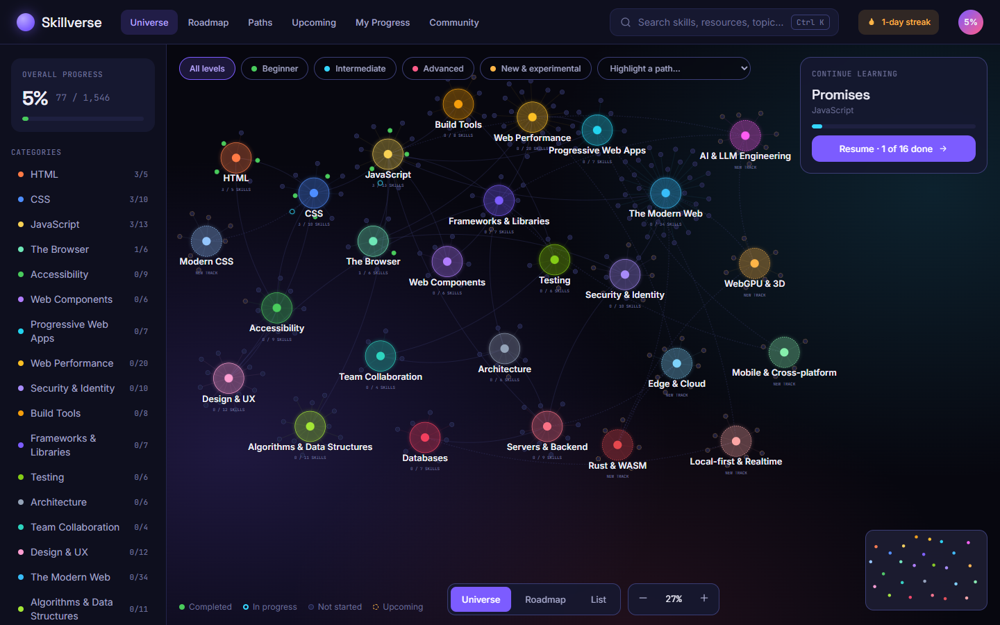
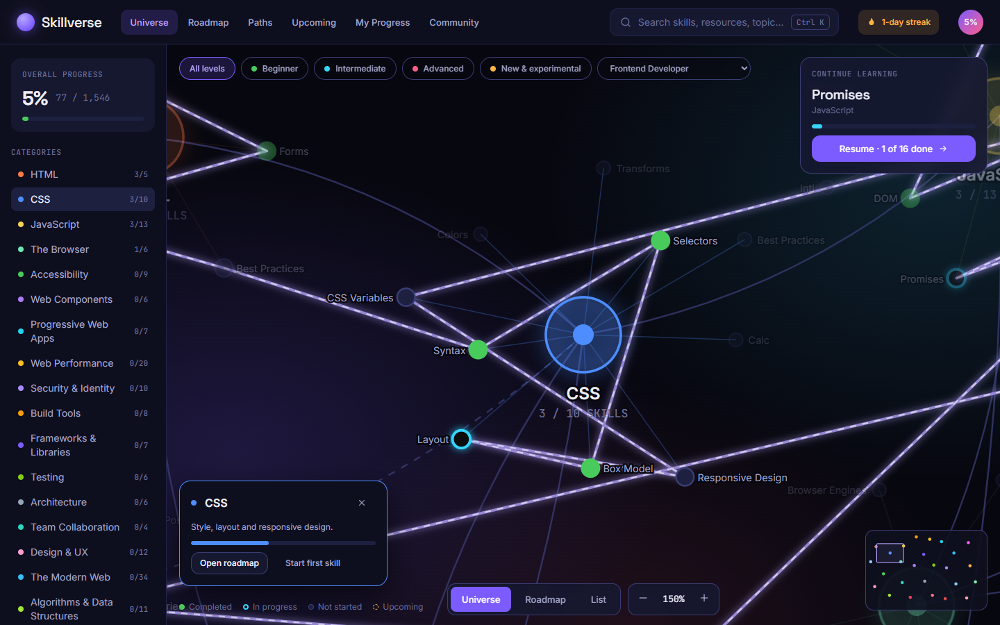
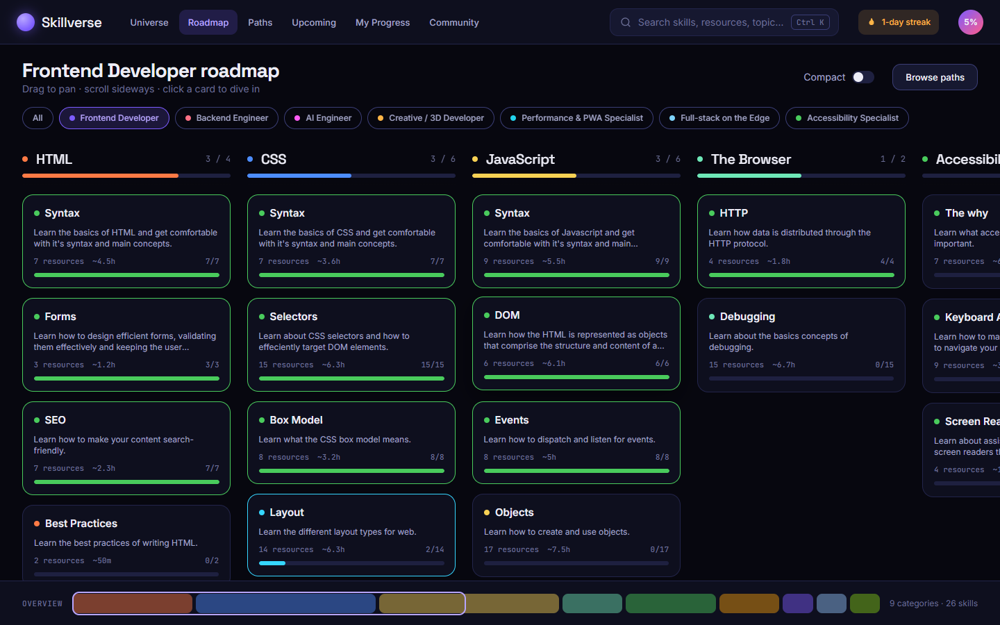
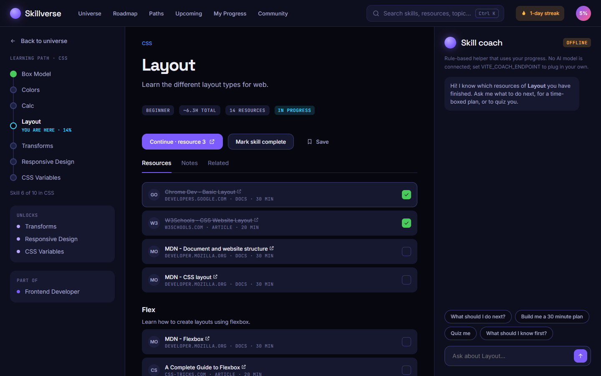
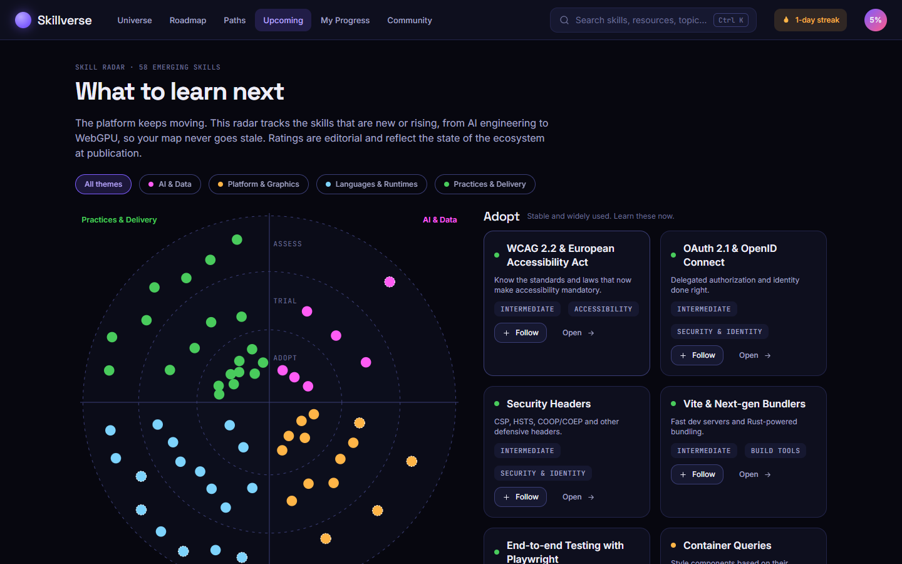
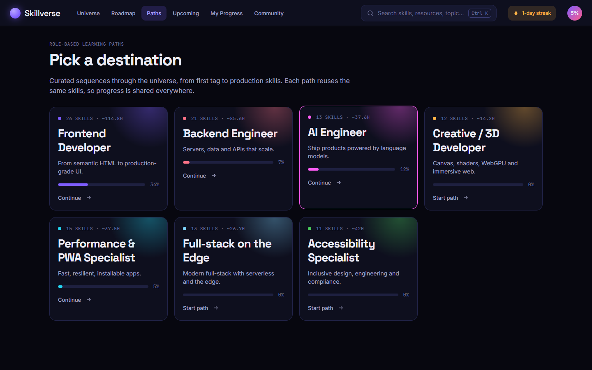
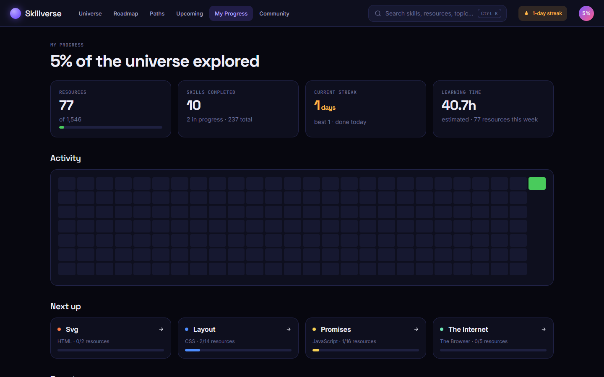
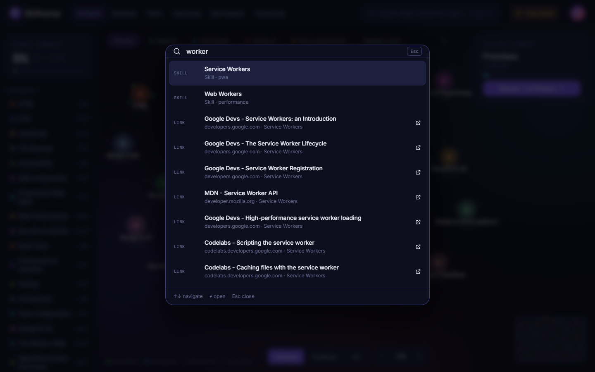
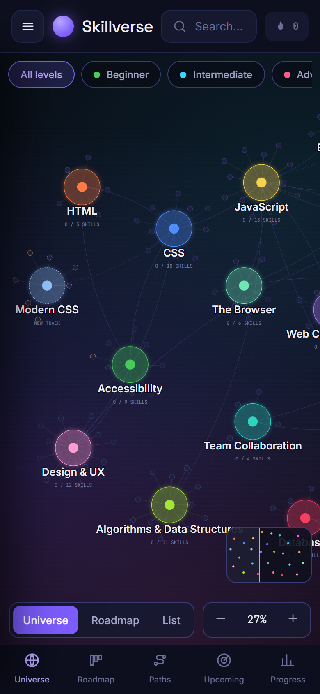

# Skillverse (Web Skills 2.0)

An interactive universe of web skills: a pannable, zoomable constellation of **237 skills** and **1,546 curated resources** across **26 categories**, with learning paths, progress tracking, a skill radar for upcoming technologies and a command palette.

It is a rebuild of [Web Skills](https://andreasbm.github.io/web-skills/) by Andreas Mehlsen (MIT). The original 179 skills and their resources are reused with attribution; Skillverse adds 58 new skills (AI & LLM engineering, WebGPU, edge/cloud, Rust & WASM, modern CSS, security, local-first, mobile and more).

<p align="center"><a href="https://buymeacoffee.com/ashishbhoure"></a></p>

<p align="center"></p>

## Screenshots

| Learning path in the universe | Roadmap view |
| --- | --- |
|  |  |

| Skill page with coach | Upcoming skills radar |
| --- | --- |
|  |  |

| Role paths | My progress |
| --- | --- |
|  |  |

| Command palette (`Ctrl+K`) | Mobile |
| --- | --- |
|  |  |

Regenerate them with `node scripts/screenshots.mjs` while the app is running.

## Run it

```bash
npm install
npm run dev        # regenerates data, starts Vite on http://localhost:5173
npm run build      # data + type-check + production build into dist/
npm run preview    # serve dist/ on http://localhost:4173
node scripts/smoke.mjs   # browser smoke test against a running preview (needs local Chrome/Edge)
```

Requires Node 18+. The build is fully static (hash routing, relative asset paths), so `dist/` can be hosted anywhere, including GitHub Pages.

## Features

| Area | What it does |
| --- | --- |
| **Universe** (`/`) | SVG constellation with drag-pan, wheel/pinch zoom, keyboard zoom, fly-to-category, level filters, layer toggles, highlighted learning path, hover cards, minimap |
| **Roadmap** (`/roadmap`) | Original-style horizontal columns, drag-to-scroll, compact mode, path filter, overview strip |
| **Paths** (`/paths`) | 7 role-based paths (Frontend, Backend, AI Engineer, Creative/3D, Performance & PWA, Full-stack on the Edge, Accessibility) |
| **Skill page** | Prerequisite chain, resources grouped by topic, per-resource checkboxes, private notes, save, experimental warnings, skill coach |
| **Upcoming** (`/upcoming`) | Radar of emerging skills (Adopt / Trial / Assess) by theme, follow list |
| **My Progress** | Stats, streaks, 26-week heatmap, per-category bars, achievements, export / import / reset |
| **⌘K / Ctrl+K / `/`** | Command palette over pages, categories, skills and all resources |
| **List** (`/list`) | Accessible, searchable list of every skill (non-visual alternative to the map) |
| **PWA** | Web manifest + service worker (offline after first load in production builds) |

Responsive: below 860px the nav collapses to a bottom tab bar and the category sidebar becomes a drawer.

## Data pipeline

```
data/blueprint.md ──► scripts/parse-blueprint.mjs ─┐
scripts/taxonomy.mjs (categories, links, new skills, paths) ─┴► scripts/build-data.mjs ──► src/data/skills.generated.json
```

- **Add a skill / track**: edit `EMERGING` (or `CATEGORIES`) in `scripts/taxonomy.mjs`, then `npm run data`. Duplicate IDs or unresolved path entries fail the build.
- **Add a path**: append to `PATHS`. Entries are `"category:Original skill name"` or `"category/skill-slug"`.
- Category positions (`pos`) drive the universe layout; skills spiral around their category.
- Levels and durations are **heuristic estimates** (by category and resource type), not measured data.
- The 58 new skills' links are curated from primary documentation sites. Please re-verify them before publishing, since links rot.

## Progress and privacy

All progress, notes and follows live in `localStorage` under `skillverse:v1`. Nothing is sent anywhere. Use **My Progress → Export** to back up or move devices. There is no account system; the original's Google sign-in was intentionally not carried over.

## Skill coach

The coach on each skill page is a **deterministic, rule-based helper** (next resource, time-boxed plan, self-quiz, prerequisites). It is not an AI model and is labelled "Offline" in the UI. To connect your own LLM backend, set `VITE_COACH_ENDPOINT` at build time; the app will `POST` `{ skill: {id,name,description}, question, completed }` and expect `{ answer: string }`, falling back to the local helper on failure.

## Project layout

```
src/
  lib/        data indexes, progress store, layout, search, coach
  components/ nav, command palette, shared UI
  pages/      Universe, Roadmap, Paths, SkillPage, Upcoming, Progress, Misc (List, Community)
  styles/     design tokens + all styles (tokens mirror the Figma "Foundations" page)
scripts/      data pipeline + browser smoke test
```

<!--  ## Credits and licence

Original skill data: [andreasbm/web-skills](https://github.com/andreasbm/web-skills), MIT © Andreas Mehlsen. Fonts: Space Grotesk, Inter, JetBrains Mono (Google Fonts, loaded from the CDN). -->
